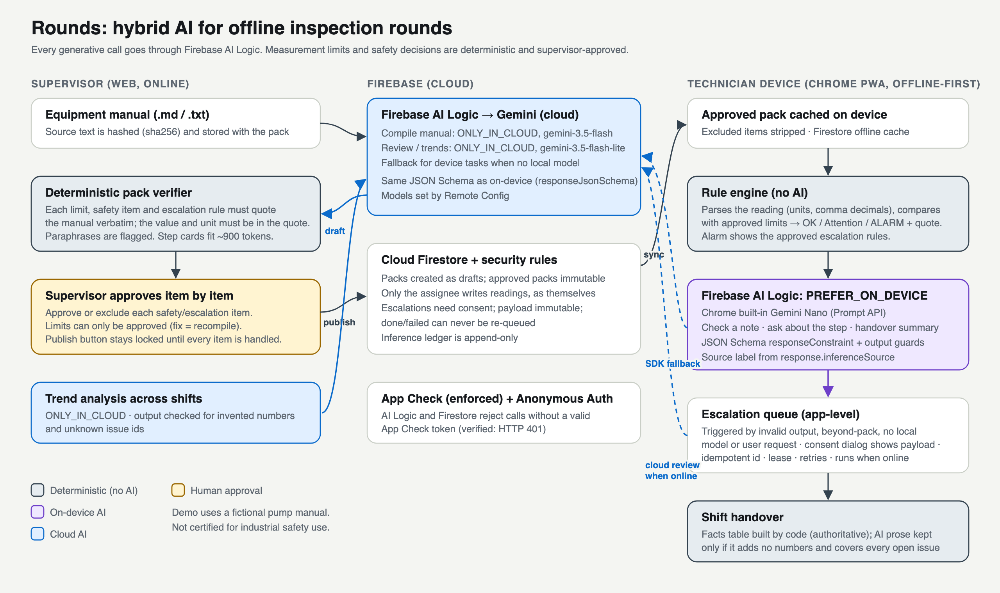

# Rounds

**Offline inspection rounds with hybrid AI. The cloud reads the manual, the device helps in the field, and rules decide what is safe.**

Rounds is a web app (installable PWA) for equipment inspection rounds in places with poor connectivity, such as pump rooms, basements and plant floors. It uses [Firebase AI Logic](https://firebase.google.com/docs/ai-logic) hybrid inference:

- **Cloud (Gemini through Firebase AI Logic)** turns a long equipment manual into a small *procedure pack*. It also reviews escalated cases and finds problems that recur across shifts.
- **On-device (Chrome's built-in Gemini Nano through Firebase AI Logic)** helps the technician during the round, even with no network. It checks a free-text note against the step, answers questions from the approved pack, and drafts the shift handover.
- **Deterministic code, with no AI,** checks every measurement against limits that a supervisor approved line by line, each traced to a verbatim quote from the manual.

> ⚠️ The demo uses a **fictional** pump manual (`shared/fixtures/manual-aqualift-cp40.md`, marked DEMO ONLY). Rounds is a hackathon prototype. It is **not certified for industrial safety use**, and AI output never overrides an approved procedure.

**Live demo:** https://rounds.hayaix.tech (desktop Chrome with built-in AI for on-device inference)

**Demo video (2:59):** https://youtu.be/Zj5bSjHjnFY

**Legal:** [Terms of Service](https://rounds.hayaix.tech/terms) · [Privacy Policy](https://rounds.hayaix.tech/privacy) · [Disclaimer](https://rounds.hayaix.tech/disclaimer)



## Why hybrid

| Task | Where it runs | Why |
|---|---|---|
| Check a reading against limits | **Rules** (no AI) | Safety-relevant, so it must be deterministic and traceable to the manual |
| Check a note, ask about a step, write the handover summary | `PREFER_ON_DEVICE` | Short, single-turn and structured, so it works offline and notes stay on the device. On a device with no local model, the SDK's cloud fallback is used only after the user turns on **Cloud fallback**; otherwise the app offers a consented cloud review. |
| Compile a manual into a pack | `ONLY_IN_CLOUD` | Done once per manual revision. It turns prose limits into typed rules the app can enforce. Each on-device call then carries one small step card instead of the whole manual. Measured in Chrome on the 18 KB demo manual: a note check is 338 tokens with a step card vs 4,744 with the full manual, ran in 34–49 s vs 109–140 s, and flagged the out-of-limit reading in 3 of 3 runs vs 0 of 3. Real manuals are far longer than Chrome's 9,216-token window. |
| Escalated review, cross-shift trends | `ONLY_IN_CLOUD` | Gets context the device calls don't carry: the verbatim manual section and this check's history across shifts. Queued while offline and sent only after the user consents. |

The app keeps four mechanisms separate (`web/src/ai/hybrid.ts`):

1. **SDK fallback.** `InferenceMode.PREFER_ON_DEVICE` lets Firebase AI Logic choose between the device and the cloud. On a device with no local model it is allowed only after the user opts in.
2. **App-level escalation.** The app decides to re-run a case in the cloud when the local output is invalid, the question is beyond the pack, no local model exists, or the technician asks.
3. **Offline queue.** Each escalation is stored with an idempotent id. It runs when the connection returns, with a lease and retries.
4. **Deterministic validation.** Every AI result must pass JSON Schema validation (Ajv) and output guards before it is shown.

The **source label** on every AI result ("On-device" or "Cloud") comes from the SDK's `response.inferenceSource`. The app never guesses it. Every call is appended to a *Hybrid ledger* (Firestore, append-only) with its mode, source, latency and validity. The ledger view shows the calls made in the current browser session.

## Safety design

- **Every limit is quoted and approved.** The compiler must attach a verbatim quote from the manual to each limit, safety precaution and escalation rule. The code checks that the quote exists in the manual and that the value and unit appear inside it (`web/src/domain/pack.ts`). Safety text that is not itself verbatim is flagged as a paraphrase.
- **The supervisor approves item by item.** "Approve all" only covers items with no findings. Safety and escalation items can be excluded, and excluded items never reach technicians or the on-device model. A limit can't be excluded; it can only be fixed by recompiling. Publish stays locked until every item is handled.
- **The security rules enforce it too** (`firestore.rules`):
  - Packs are created as drafts, and only a supervisor can approve them.
  - Approved packs are immutable and can only be retired.
  - Only the assigned technician can write readings, and only as themselves.
  - An escalation must carry a consent timestamp (the client writes it after the consent dialog; it records consent, it can't prove it), its payload can't change after that, and a finished escalation can't be re-queued.
  - The ledger is append-only.
- **The AI never judges numbers.** Readings are parsed (units, comma decimals) and compared with the approved limits in code. AI comments containing numbers are removed, and the removal is shown to the user. AI text that introduces numbers not in the pack or the note is rejected.
- **Alarms show the approved escalation rules, not AI advice.** When a check is out of limits again after an earlier shift's deviation, a rule-based banner shows the approved rule for repeated deviations.
- **Handover facts come from code.** The table of readings and open issues is built from recorded data. The AI summary is rejected (rule-based template instead) if it adds numbers or calls the equipment stable or normal while a reading is out of limits. Every open issue gets an action: missing or off-topic AI actions are replaced by a rule-based one, and the correction is shown.
- **Nothing is uploaded without consent.** The cloud review dialog shows the exact text that will be sent, and the user can edit it. No names or photos are included. On a device without a local model, notes go to the cloud only after the user turns on **Cloud fallback**.
- **App Check is enforced** on AI Logic and Firestore. Calls without a valid token were checked to fail with HTTP 401.

## Try the demo flow

1. **Supervisor** → *Compile a manual* → *Use demo manual* → *Compile with cloud AI*.
2. Review the draft: every item shows its manual quote. Approve the clean items, exclude anything you disagree with, then *Publish*.
3. *Seed demo history (synthetic)* adds two earlier shifts with labelled synthetic readings. Then *Assign round*.
4. **Technician** → *Start*. The pack is now cached. Go offline (DevTools → Network → Offline) and:
   - record readings, for example `4.1` bar, `76` °C, `5,2` mm/s, and watch the rule results;
   - write a note → *Check my note (local AI)*, which shows the On-device label;
   - *Request detailed cloud analysis* → read the payload → *Queue for later*.
5. Reconnect. The queued review runs in the cloud automatically.
6. *Complete round*. The handover is written on-device, with the facts table underneath.
7. **Supervisor** → *Find recurring problems (cloud)*. **Hybrid ledger** shows each call from this session and its real source.

## Run it locally

Requirements: Node 24, the Firebase CLI, and a Firebase project on the free Spark plan.

On-device AI requires desktop Chrome with the built-in Prompt API (tested on Chrome 157) on hardware that meets Chrome's requirements: 16 GB RAM, a GPU with more than 4 GB VRAM, and about 22 GB of free disk. On other browsers everything else still works. Note checks, questions and handovers then need **Cloud fallback** switched on (results are labelled "Cloud"), or the handover uses its rule-based template.

1. In the Firebase console for your project:
   - **Authentication** → enable **Anonymous** sign-in.
   - **AI Logic** → Get started → **Gemini Developer API**.
   - **Firestore** → create the database.
   - **App Check** → register the web app. Add a **debug token** for local development. For hosted builds, create a score-based key in **Google Cloud Fraud Defense** (formerly reCAPTCHA Enterprise; the reCAPTCHA Classic option is deprecated) in the same project, with your hosting domains, and register it under the Fraud Defense provider.
2. Deploy the rules, indexes and Remote Config template:
   ```bash
   firebase deploy --only firestore,remoteconfig --project <your-project-id>
   ```
3. Configure and start the web app:
   ```bash
   cd web
   cp .env.example .env.local
   ```
   Fill in `.env.local` from `firebase apps:sdkconfig WEB`, then:
   ```bash
   npm install
   npm run dev
   ```
4. In Chrome, click **On-device AI: download** in the top bar. The first download needs a click, because Chrome requires a user gesture.

Models are set by Remote Config (`compile_model`, `cloud_model`). There is also a kill switch for cloud escalations.

## Tests

```bash
cd web && npx vitest run
```
30 domain tests cover unit parsing, threshold checks, quote verification, the publish lock, exclusions, output guards, manual sections, repeat deviations, and the handover guards and repair.

```bash
npm --prefix rules-test test
```
16 Firestore security-rules tests run on the emulator.

`tools/ui.mjs` drives the real app in Chrome through the DevTools protocol. It was used to record the evidence screenshots in `evidence/` and the measured results in [STATUS.md](STATUS.md).

## Project layout

```
shared/schema/     JSON Schemas shared by the on-device responseConstraint, the cloud responseJsonSchema and the validator
shared/fixtures/   Fictional demo manual and a hand-written reference pack (tests only)
web/src/domain/    Deterministic logic: measurement, pack verification, guards, handover (no AI, no Firebase)
web/src/ai/        Hybrid inference layer, prompts, escalation queue, ledger
web/src/data/      Firestore access (offline-first, writes never block the UI)
web/src/views/     Supervisor, Technician, Handover, Hybrid ledger
firestore.rules    Server-side enforcement of approval, consent and immutability
```

## Known limitations

- **Web only.** An iOS client (Apple Foundation Models through Firebase AI Logic) was planned but not built. The available Xcode can't use the current Firebase iOS hybrid API.
- **Latency.** On the test machine (Intel MacBook Pro, Radeon 5500M) on-device calls took 10–80 s. Newer GPUs are faster.
- **Hardware.** On-device AI in the browser needs a desktop or laptop that meets Chrome's requirements. Technicians usually carry phones and tablets, so field use depends on mobile on-device models (iOS Foundation Models, Android Gemini Nano). Without one, Rounds still runs offline, with rules only and cloud help when connected.
- **Coverage.** The compiler can miss qualitative criteria. In testing it dropped "a continuous stream is a deviation" from the seal check. Supervisor review is the control for this, but it depends on the reviewer.
- **Text only.** Manuals must be text (.md/.txt) so every quote can be verified. PDF input is not enabled.
- **Simplified roles.** Each demo user works in an isolated workspace and holds both the supervisor and technician roles.

## License

[Apache License 2.0](LICENSE)
